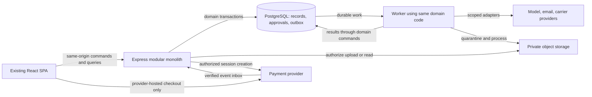

# AURA platform architecture · Phase 1 design for review

Baseline: `21f728190e07dc9a9442814d45523265f74e097d`. **Today:** HOLO React/Vite storefront and configurators, browser-local previews and same-origin Express diagnostics. **Target below:** contracts for later work, not deployed components, routes, models or approvals. Keep the existing visual system, keyboard/navigation behavior, statuses and routes; replace preview data sources one approved use case at a time. Never seed real orders, products or identities from preview content.

## System context (proposed)

One TypeScript application, one schema history and one authoritative PostgreSQL database. If asynchronous work becomes necessary, use another process from the same release, not independently deployed domain services. Lines to PostgreSQL represent module-owned repositories, not SQL access by agents or browsers. Configuration, provider adapters, policy checks and observability are infrastructure; business decisions remain in domain services. Do not import another module's repository. Use synchronous typed commands when the caller needs acceptance; use versioned post-commit events for projections, notifications and provider side effects. Read models can join by approved views but cannot mutate their sources. See [API architecture](AURA-API-ARCHITECTURE.md) for failure/retry behavior.

## Who owns each decision?

| Domain | Owns / may decide | May consume, but cannot confer |
|---|---|---|
| Identity and access | Subject mapping, session and organization membership, capability grants | Provider assertion; a login does not verify a manufacturer |
| Customer accounts | Private customer profile, preferences, addresses and consent | Identity; public community profile is a separate projection |
| Sellers and manufacturers | Organization onboarding, evidence, scopes and verified capabilities | Human verification; seller status alone is not manufacturing approval |
| Marketplace | Seller listings, visibility, commercial approval and versioned offers | Catalog variants, verified specs and approved price source; browsing is not stock reservation |
| Catalog and inventory | Product identity, categories, variants; inventory owns per-seller/location balances, holds and movements | Listing reference; order service requests a reservation, never edits balances directly |
| Cart, checkout and orders | Server cart, repriced quote, checkout intent, order and vendor-specific order lines/suborders | Offers and inventory; draft cart totals and redirects are not payment outcomes |
| Payments and refunds | Provider intent mapping, verified event ledger, reconciliation and refundable balance | Authorized order amount; refund approval is distinct from refund settlement |
| AI design studio | User-requested generation job and output draft | Authorized source assets and budget; output has no engineering approval |
| Design editing/history | Immutable revisions, parentage, variations, provenance, reviewable specification | Generated/manual draft; editing forks a new revision rather than changing approved history |
| 3D customization | Compatible option constraints, units, geometry/asset refs, versioned parameter set | Variant and design revision; visual fit is not a feasibility test |
| Community | Public profiles, published revision snapshots, moderated comments, likes and private saves | Explicit share grant; discovery/social counts confer no purchase rights |
| Product Lab | Customer suggestions, proposals and discussions for a defined problem | Consented community inputs; proposal is not a listing |
| Demand intelligence | Versioned clusters, recommendations and aggregate interest projections | Permitted signals; cluster membership is revisable and never binding |
| Manufacturer review and quotes | Human feasibility decision against exact spec, quote revision with terms, capacity, expiry | Verified org/capabilities; AI cannot sign the decision |
| Collective campaigns | Threshold, deadline, accepted quote, immutable terms and close outcome | Verified quote and committed units, not likes; change of terms requires new consent |
| Commitments | Explicit customer assent, units, versioned cancellation window, cancellation/expiry record | Campaign terms and verified funding prerequisite if required; never silently upgrade a pledge |
| Production and quality | Approved production order, batch milestones, inspections and release/hold | Successful campaign/order and authorized funding; passing QA requires accountable evidence |
| Fulfillment | Seller-scoped packages, line allocations, carrier events, returns logistics | Verified QA release/order readiness; a label does not mean delivered |
| Agent operations | Delegated read/propose tasks, budgets and action requests | Same APIs/policies as other callers; cannot authorize payment or move money |
| Administration, audit, notifications | Scoped casework/moderation and approvals; append-only accountability and delivery of committed events | Admin commands call domain owners; sending an email cannot commit a transaction |

## Walk one design through the platform

A customer forks a draft, changes parameters and explicitly publishes one revision. Community engagement may prompt a Lab proposal. Demand analysis suggests a cluster; a human selects a candidate specification. Technical validation checks dimensions, units, allowed options and immutable references. A verified manufacturer reviews **that revision** and supplies a time-limited quote. Marketplace approval for sale is a further independent decision. A campaign can solicit explicit commitments on approved terms; funding is separately verified. Only a successful close and authorized release create production work. Fulfillment follows QA, not a generated image. A later automotive design must pass the same gates plus applicable specialist/safety approval; no automotive integration is proposed now.

**Distinct facts:** generated image ≠ validated specification ≠ manufacturable item ≠ approved listing. Interest ≠ commitment ≠ settled payment. A revision, quote expiry or withdrawn publication must not silently change a purchased specification or grant further public access.

## AI subsystem (future)

Use capability-specific adapters rather than a single privileged chat tool. Generation consumes a user brief; editing consumes an authorized immutable source revision and produces a child. Recommendations rank eligible catalog IDs; semantic search embeds authorized text; demand clustering produces aggregate evidence with date range, methodology, model version and uncertainty. Manufacturer assistance drafts questions or summaries, never capabilities or signed decisions. Agents propose scoped commands and explain sources. Hydrate displayed prices/stock from authoritative queries **after** ranking. If unavailable, report unknown, not an inference.

A job records actor, purpose, tenant, input revision/hash, prompt-template version, provider/model/version, generation parameters, policy version, budget reservation and result references. Store valuable outputs immutably; replay is not guaranteed identical. Pin/evaluate template and model changes with synthetic safety, relevance and leakage checks; support rollback to the previous version. Submit only approved, minimized inputs to providers with approved retention/region terms. Enforce per-user/org concurrency, per-job resource limits and hard spend ceilings before dispatch; record estimated versus actual usage, cancel or reject when exhausted. Never blindly retry a paid request with uncertain outcome. Treat outputs as untrusted media/text; validate schema and scan assets before visibility. No model or embedding service has been selected.

## Infrastructure and release boundaries (proposal, not provisioning)

| Environment | Topology and rules |
|---|---|
| Local | Existing loopback Vite → Express proxy; optional local Supabase diagnostics. Keep readiness unavailable if no DB. No payment/model keys needed. |
| Tests / CI | Disposable storage, synthetic identities/data, controlled HTTP transport, embedded SQL replay and browser smoke. Existing workflow is verification only, not CD. Add PostgreSQL role/concurrency integration before trusting transactional code. |
| Private staging | Only after authorization: access-controlled same-origin frontend/API ingress, isolated PostgreSQL, private buckets, sandbox providers, separate secrets, synthetic data. Rehearse duplicate events, restore, rollback and disabled integrations. |
| Production | Separate project/network/roles/keys; serve static assets from same origin or CDN with explicit origin/security policy; TLS to ingress and DB. Stateless API instances; bounded DB pool, scale workers independently by queue age. Private originals, signed short-lived delivery; CDN only for approved public derivatives. No public production target approved. |

Begin without Redis; durable jobs/outbox in PG. Consider Redis only for ephemeral quotas/cache/queue wake-ups if profiling justifies cost. Cache keys include authorization scope/version; fail closed for paid actions if quota authority is unavailable. Email/carrier/model outages should degrade individual functions, not browsing. Record structured, redacted logs, latency/error metrics, DB saturation, worker lag, provider cost and reconciliation age. Alert named operators on failed restores, stuck payments, runaway spend and sustained authorization failures; do not log inputs or payment payloads. Require encrypted point-in-time DB backups, versioned asset backups, key recovery and restore drills (including object/database consistency and replay deduplication). Business owners must set recovery time/data-loss objectives before hosting. CI builds immutable artifacts; promotion requires human sign-off, scoped migration plan, health checks and a tested rollback/roll-forward path. No deployment pipeline added.

Read alongside [database ownership](AURA-DATABASE-ARCHITECTURE.md), [security](AURA-SECURITY-ARCHITECTURE.md) and [decision records](AURA-ARCHITECTURE-DECISIONS.md).
